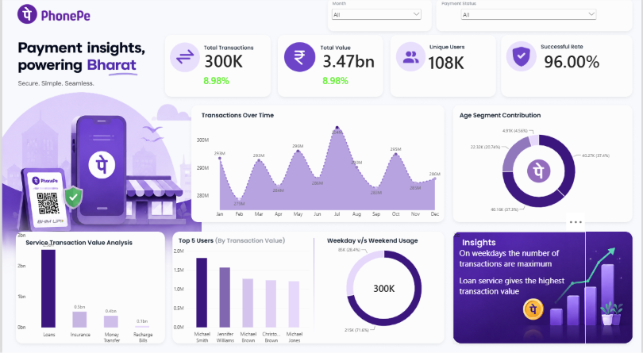

# PhonePe Payments Analysis — Power BI Dashboard

**Krishna Sahani · Data Analytics Portfolio**

A Power BI dashboard exploring payment activity, transaction value, service contribution and user demographics. The report brings together headline KPIs, time trends, service comparisons and user segments in a PhonePe-inspired purple visual design.

*Actual dashboard screenshot supplied by the author. The PBIX in this repository is the exact attached project, with a simplified filename.*

[Download the Power BI project](PhonePe_Payments_Analysis.pbix) · [Project documentation](docs/Project_Details.md) · [DAX measures](docs/Measures.dax)

## Objective

Make payment activity easier to review by answering these questions:

- What are the total transaction count, value and reported user population?
- Which services contribute the most transaction value?
- How does transaction value change across months?
- What share of activity occurs on weekdays versus weekends?
- How are users distributed across the dataset's age-segment labels?

## Tools

| Tool | Role |
| --- | --- |
| Power BI Desktop | Data model, visual report and slicers |
| DAX | Transaction, value, user, success-rate and period-comparison measures |
| Power Query | Data preparation layer in the supplied PBIX |

## Dashboard KPIs

| KPI | Screenshot display | Full-data definition / value |
| --- | ---: | --- |
| Total transactions | 300K | 300,000 transaction records |
| Total value | ₹3.47bn | Sum of Amount: ₹3,474,321,934.16 |
| Unique users | 108K | 107,658 distinct IDs in the registered-user table |
| Successful rate | 96.00% | 287,993 successful transactions / 300,000 transactions |

The Unique Users KPI represents the registered-user population. The number of distinct users present in transaction records is 100,761, a different metric. Transaction value includes the supplied amounts across payment statuses and is not a settled-revenue measure.

## Dashboard sections

- **KPI cards:** transactions, transaction value, registered users and success rate.
- **Transactions Over Time:** monthly transaction **value**, shown in millions.
- **Age Segment Contribution:** distribution of registered users by source age-segment label.
- **Service Transaction Value Analysis:** Loans, Insurance, Money Transfer and Recharge Bills.
- **Top 5 Users:** transaction value grouped by the names used in the supplied visual.
- **Weekday vs Weekend Usage:** transaction-count contribution by day type.
- **Filters:** Month and Payment Status slicers.
- **Insights panel:** summary observations displayed within the dashboard.

## Findings from the supplied data

1. **Loans dominate transaction value**, contributing approximately ₹2.53bn, or 72.89% of the total.
2. **Weekdays account for 71.6% of transactions** (214,812), versus 28.4% on weekends (85,188).
3. **July has the highest monthly transaction value**, approximately ₹304.49 million.
4. **Successful transactions account for approximately 96.00%** of all transaction records.

These are descriptive observations. The data does not establish the causes of the patterns. See the project notes for limitations affecting time comparisons and name-based rankings.

## Open the report

1. Download `PhonePe_Payments_Analysis.pbix` using the link above. If GitHub shows a binary-file page, use its Download raw file control.
2. Open the file in Power BI Desktop. The supplied PBIX contains imported data.
3. Review the dashboard, then try the Month and Payment Status selections. Check the model and measure definitions before relying on period comparisons.
4. For refresh on another computer, inspect Transform data → Data source settings and update the original source locations or credentials if required. Standalone upstream source files are not included here.

GitHub displays the screenshot and documentation; it does not run an interactive PBIX dashboard. The uploaded binary and image are checked against the author's supplied files. Native Desktop opening and refresh have not been tested during publication.

## Files

| Path | Contents |
| --- | --- |
| `PhonePe_Payments_Analysis.pbix` | Author-supplied report, unchanged contents |
| `images/dashboard.png` | Author-supplied dashboard screenshot |
| `docs/Project_Details.md` | Model overview, definitions and interpretation notes |
| `docs/Measures.dax` | Existing DAX measures transcribed from this exact binary's previously inspected contents |
| `docs/Verified_Totals.json` | Independent full-dataset aggregates |
| `docs/File_Integrity.json` | Input filenames, sizes and SHA-256 checksums |

## Author

**Krishna Sahani** · [LinkedIn](https://www.linkedin.com/in/krishna-sahani-87684839a/) · [GitHub](https://github.com/krishna-sahani)

Portfolio project using the author's supplied dataset and brand-themed report. No official PhonePe affiliation is claimed. The original dataset's upstream publisher and redistribution licence have not been established; no new licence is assigned to supplied data or brand assets.
